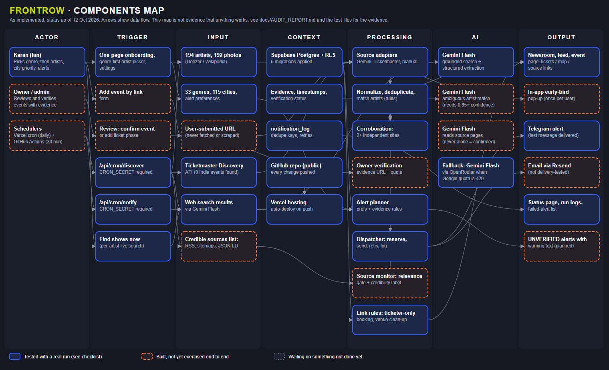

# FrontRow

*(formerly "Live Show Radar"; the name lives in one place, `src/lib/brand.ts`.)*

Indie-first concert discovery and ticket alerts for India, Bengaluru first. Pick your artists, genres and cities by tapping, get a Telegram or email alert when a show is announced, and see an early-bird warning **only when the phase and its deadline are verified with evidence**.

Built for the MESA C4 AI final exam (problem: *Live Show Radar*). All AI tasks use Gemini Flash.



Editable source: [docs/components-map.svg](docs/components-map.svg) (regenerate with `node scripts/build-components-map.mjs`). Honest per-check scores: [docs/NINE-CHECKLIST.md](docs/NINE-CHECKLIST.md).

## What it does

- **Discovers** shows for followed artists using Gemini Flash with Google Search grounding and the Ticketmaster Discovery API, plus a manual **Add event by link** form. It does **not** scrape BookMyShow, District or SkillBox.
- **Never overstates certainty.** Search and AI results start as *Unconfirmed*. Two independent websites make it *Reported by 2+ sites*. Only an official API record or an owner review with an evidence URL and a quoted line makes it *Verified*. Ticket deadlines are never guessed.
- **Alerts** on Telegram and email (independent channels, deduplicated, retried at most 3 times, failures visible).
- **Personalised by tapping, not typing**: a 3-step "Pick your scene" flow, a 176-artist catalogue shown as tiles with genre and type filters (one tap follows and saves), 33 genres, and 115 cities grouped by region. Multiple genres use OR logic, Bengaluru is the default priority city, other cities are never hidden, and everything is saved in Supabase. Missing an artist? "Add an artist" creates one with aliases.
- **The feed follows your picks.** Once you follow anyone, the feed defaults to **My artists**; switch to **+ my genres** or **Everything** with one tap. Following an artist starts a background search for their shows, and **Find shows now** searches every followed artist that hasn't been searched in 24 hours (one at a time, with live progress). The 30-minute scheduler only searches artists somebody follows.
- **City priority is an ordered list.** Pick cities, then choose your #1: its shows are listed first (Bengaluru by default), then #2, and so on. Other cities are never hidden.
- **Book show** on every event opens the stored ticket link, or else the best listing page (ticketing sites first, social posts last), and says which it is. FrontRow never sells tickets and never invents a link.
- Seed or extend the catalogue with `node --env-file=.env.local scripts/seed-catalog.mjs` (edit `src/lib/catalog/*`). Being in the catalogue says nothing about whether an artist has shows: only discovery evidence does.

## Tech

Next.js 16 (App Router, Cache Components) · TypeScript · Tailwind v4 · Supabase (Postgres, Auth, RLS) · Gemini Flash · Telegram Bot API · Resend · Vercel + GitHub Actions.

## Run it locally

```bash
npm install
cp .env.example .env.local     # then fill in the values (never commit this file)
npm run dev
```

Set `LOCAL_OWNER_MODE=true` in `.env.local` to skip the login while testing on your own computer. It is ignored in production builds and on Vercel.

### Environment variables

| Name | Purpose | Secret? |
|---|---|---|
| `NEXT_PUBLIC_SUPABASE_URL`, `NEXT_PUBLIC_SUPABASE_PUBLISHABLE_KEY` | Supabase project (safe in browsers when RLS is on) | No |
| `SUPABASE_SECRET_KEY` | Server-only database access | **Yes** |
| `GEMINI_API_KEY`, `GEMINI_MODEL` | Search and extraction (`gemini-flash-latest`; `gemini-2.5-flash` is closed to new accounts) | **Yes** |
| `TICKETMASTER_API_KEY` | Discovery API | **Yes** |
| `TELEGRAM_BOT_TOKEN`, `TELEGRAM_CHAT_ID` | Telegram alerts | **Yes** |
| `RESEND_API_KEY`, `ALERT_FROM_EMAIL`, `ALERT_TO_EMAIL` | Email (the free test sender is `onboarding@resend.dev` and only delivers to your own Resend account email) | **Yes** (key) |
| `CRON_SECRET` | Protects `/api/cron/*` | **Yes** |
| `ADMIN_EMAILS` | Who can use Review and Status | No |
| `APP_BASE_URL` | Public https URL used for links inside alerts | No |
| `NOTIFICATIONS_ENABLED`, `AUTO_DISPATCH_ON_REVIEW`, `DISCOVERY_ARTISTS_PER_RUN`, `DISCOVERY_CORROBORATE_PER_RUN` | Optional switches and tuning | No |

Secrets are server-side only. A scan (`node --env-file=.env.local scripts/scan-secrets.mjs`) checks committable files and the browser bundle for your real secret values.

## Database

Migrations are in `supabase/migrations/` (apply in order in the Supabase SQL editor, or with the Supabase CLI). Row Level Security is on for every table. Shared data is written only by the server with the secret key.

## Tests

```bash
node --test scripts/feed.test.mjs scripts/discovery.test.mjs scripts/notify.test.mjs scripts/catalog.test.mjs   # 48 unit tests, no network
node --env-file=.env.local scripts/test-db.mjs             # schema, RLS, constraints (live Supabase)
node --env-file=.env.local scripts/check-integrations.mjs  # which services are configured and reachable
node --env-file=.env.local scripts/test-notify-failure.mjs # failure and retry handling (sends nothing real)
node --env-file=.env.local scripts/test-notify-live.mjs    # sends ONE labelled TEST Telegram message
node --env-file=.env.local scripts/run-notify.mjs --dry    # preview which alerts would be sent
npm run lint && npx tsc --noEmit && npm run build
```

## Scheduler

Vercel's free Hobby plan only runs cron once a day, so [.github/workflows/scheduled-discovery.yml](.github/workflows/scheduled-discovery.yml) calls `POST /api/cron/discover` every 30 minutes (GitHub may delay runs by a few minutes). Add two repository secrets: `SITE_URL` (your Vercel URL, no trailing slash) and `CRON_SECRET` (same value as in Vercel).

Each call searches the next unsearched artist (oldest first), second-checks one pending event, then sends deduplicated alerts. Calls can overlap safely. **A full sweep of N followed artists therefore takes roughly N / (parallel calls) intervals.** With 5 artists and 2 parallel calls that is about 3 intervals. For 60 artists it would be about 15 hours, so raise `DISCOVERY_ARTISTS_PER_RUN` or `PARALLEL_CALLS` only after checking your Gemini quota. Do not read "every 30 minutes" as "every artist every 30 minutes".

## Operations: if something stops working

| Symptom | Check |
|---|---|
| No new alerts | Status page: last discovery run, failed alerts, `NOTIFICATIONS_ENABLED`. GitHub Actions tab: did the workflow run and succeed? |
| Gemini errors (401/404/429) | Create a new key at aistudio.google.com/apikey; check `GEMINI_MODEL` is still available; free-tier quota may be exhausted. |
| Telegram failures | Bot token revoked? Send `/start` to the bot again. `TELEGRAM_CHAT_ID` is your own user id. |
| Email failures | Resend test sender only delivers to your Resend account email. Verify a domain to email others. |
| Supabase paused | Free projects pause after inactivity; resume in the dashboard. |
| Rotate a credential | Create the new key at the provider, update `.env.local` and the Vercel environment variable, redeploy. For `CRON_SECRET` also update the GitHub secret. |

## Honest limitations

- **Coverage:** Ticketmaster returned no India events for the tested artists. Discovery relies on Google Search grounding, which is inconsistent run to run, so a show can be missed. BookMyShow, District and SkillBox are not integrated.
- **Verification:** nothing is verified automatically from search results. Early-bird urgency requires you to review the source page and record the evidence.
- **Email** is implemented but was not delivery-tested at the time of writing; Resend's free test sender can email only one address.
- **Not fixed by design:** the app informs; you decide what to attend and buy.
